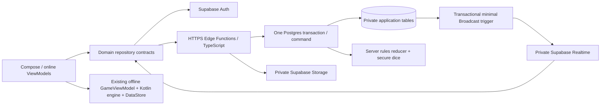

# Multiplayer architecture — specification v1

Decision date: 2026-11-12. **Design only.** No backend, Android transport, migration,
project, bucket or function is created by TASK 07.

## Repository baseline and navigation

Inspected HEAD 99b53e2 (Fix checker interaction and stabilize gameplay), its predecessor
ac75285, AGENTS.md, ARCHITECTURE.md, engine/README.md, GameModels.kt,
BackgammonEngine.kt, GameUiState.kt, InteractiveBoard.kt, GameScreen.kt,
BackgammonApp.kt, MatchRepository.kt, the application container and build configuration.
The initial working tree was clean. Historical milestone reports are context, not test evidence.

The current project has one :app module, explicit AppContainer constructor injection,
Navigation 3, immutable StateFlow ViewModels, pure Kotlin rules, one settings DataStore
and a separate active_match.bin DataStore. There is no Supabase dependency or transport.
Keep these boundaries and all toolchain versions. The engine has explicit opening rolls
and EndTurn, automatic blocked-roll passing and whole-turn compulsory-move filtering.

Read the other normative documents:
- [Protocol and snapshot recovery](protocol.md)
- [Database constraints and transactions](database-schema.md)
- [Manual rooms and lobby](rooms-and-lobby.md)
- [Quick Play](matchmaking.md)
- [Accounts, profiles and avatars](profiles-and-avatars.md)
- [Security controls and tests](security.md)
- [Milestones, verification and risks](implementation-plan.md)

When documents need clarification, protocol owns wire fields, database-schema owns
constraints/locking, security owns authorization, and this document owns system boundaries.
Change all affected specifications together; do not silently reinterpret a field.

## Authority and deployment boundary

The transaction box includes server TypeScript execution on a held database connection:
it is not a TypeScript engine executing inside PostgreSQL. Edge owns authentication,
strict request decoding, rules and CSPRNG; Postgres owns concurrency, durable records and
constraints. Never simulate a transaction with independent supabase-js REST calls.

Online Android submits intentions only. The server determines seats, starter, dice, turn,
legal moves, bar/hit/off transitions and 1/2/3-point wins. Secure random values are generated
only after authorization, deduplication and version checks. No client board/dice/result is
accepted. A state hash detects accidental divergence, not cheating by a trusted server.

Manual rooms and Quick Play share game creation, occupancy constraints and game command
handling, but never share opponent selection. Manual rooms have creator WHITE/slot 1 and
guest BLACK/slot 2. Quick Play assigns the earlier queued player WHITE. Seats do not determine
the starter; White's first die and Black's second die determine it as in the Kotlin engine.
Exactly two distinct players, standard short Backgammon, one game, no cube.

## Server command processing

Use a bounded PostgreSQL driver connection through the transaction pooler, TLS certificate
validation, prepared-statement caching disabled where required, and explicit BEGIN/COMMIT.
See [Supabase connection guidance](https://supabase.com/docs/guides/database/connecting-to-postgres).
Use a dedicated non-superuser backend role; Auth/Storage administration uses a separate
server-only secret client. No database or secret key belongs in the Android binary.
A direct SQL connection does not automatically have PostgREST's auth.uid() context. Pass the
server-verified Auth sub/session as internal helper parameters and verify session ownership;
never take those values from the request body or persist JWT settings on a pooled session.
The separate Realtime policy helper reads auth.uid()/JWT context supplied by Realtime.

A game command transaction:
1. Resolve verified Auth sub/session to an ACTIVE profile. Lock both persistent player_activity
   rows in sorted profile-ID order, then its manual room if present and the game row. Recheck identity/session/status.
2. Resolve command receipt before testing expectedVersion. A duplicate gets its original
   acceptance version plus a current snapshot; mismatched request content is rejected.
3. Check participant, seat, game status, expectedVersion, phase and turn. No RNG yet.
4. Generate secure dice if the action is an authorized roll. Evaluate the TypeScript reducer
   against the locked state; derive legal first moves from complete maximal sequences.
5. On acceptance, atomically write state/version, action, receipt, and terminal statistics/
   occupancy/room status if applicable. Commit before returning any dice or success.
6. AFTER-row trigger inserts a minimal private Broadcast notification into Realtime's
   transaction/WAL path. Snapshot fetching remains the recovery mechanism.

No external Auth HTTP call, upload, slow password hash or network request while holding
game locks. Validate the JWT/Auth user before BEGIN; a narrow server helper verifies the
session ID/status in the transaction. Bound lock acquisition and total transaction duration.
Initial targets: reducer p95 <200ms, transaction <1s normally, lock timeout 1s,
idle-in-transaction timeout 3s; these are implementation targets, not measurements.
If complex legal-sequence enumeration exceeds a safe CPU budget, return retryable failure
without mutation. Never prune legal sequences to make a deadline.

Hosted Edge limits include a 2-second CPU request budget and 256 MB memory; verify deployment
limits again in TASK 08. Engine worst-case doubles and image/password processing need
benchmarks before release. [Official limits](https://supabase.com/docs/guides/functions/limits).

## Reliable synchronization

Only server-authored, committed invalidations are sent. No base table, password, email,
dice, board or move is published to lobby/client Broadcast. A game.updated notification
carries gameId and monotonically increasing version; authenticated HTTPS returns the
authoritative snapshot, including server dice and accepted move. Own action responses can
satisfy the same version without a second fetch.

Use private channels and receive-only client policies. Realtime is a hint stream, not a
transaction log or delivery guarantee. Subscribe, then fetch; on gaps/reconnect/foreground
or 30-second active-game safety poll, fetch the latest snapshot. WAITING/search states
poll every 5 seconds while foreground. Coalesce notifications and requests per resource.
No long-lived Edge WebSocket subscribers, client-authored moves or assumed exactly-once delivery.

Database Broadcast follows committed WAL, so rollbacks cannot publish accepted actions.
Its enqueue/delivery can still fail (including the documented missing daily partition case
when no client has connected). Durable games/actions/activity and recovery polls provide
convergence even if the last notification is lost. No outbox worker is assumed or billed
in v1. If guaranteed notification retry is later needed, add an explicit transactional
outbox and dispatcher; do not claim Broadcast alone provides it.
[Database Broadcast behavior](https://supabase.com/docs/guides/realtime/broadcast).

## Android integration, without changing offline play

Future packages remain within :app initially:
- domain/auth, domain/profile, domain/online: pure IDs, snapshots, statuses and repository contracts.
- data/network: Supabase Auth/Realtime/Storage and HTTPS adapters, strict DTO/version validation.
- presentation/auth, lobby, room, matchmaking, onlinegame, profile: independent ViewModels.
- existing engine, designsystem, animation and feedback: reused without server SDK imports.
- AppContainer: instantiate the shared SDK/session scope and repositories explicitly.
  Add Hilt only when real scopes justify it.

The six contracts have specific responsibilities:

| Contract | Operations / observation |
|---|---|
| AuthRepository | Session StateFlow; email sign-up/in, Google credential exchange, refresh, logout, reauthentication/deletion request |
| ProfileRepository | Public/self profile, username claim/edit, built-in avatar, upload/replace/remove, avatar preview state |
| LobbyRepository | Bounded room search/page/refresh and coalesced availability invalidations |
| RoomRepository | Create/name/password, join, waiting snapshot/lease/cancel, active game ID |
| MatchmakingRepository | Queue ticket, renew, cancel and authoritative assignment |
| OnlineGameRepository | Fetch snapshot; submit revision-stamped command; observe invalidations/recover; no local RNG |

Create no unused Kotlin interfaces in TASK 07. Select/pin supported SDK versions and inspect
their session storage in TASK 08; Supabase documents supabase-kt as community-maintained.
[Library status](https://supabase.com/docs/reference/kotlin/introduction).

Local GameViewModel continues reducing Kotlin actions and saving local MatchRepository.
A separate OnlineGameViewModel serializes intentions, allows at most one in-flight mutation,
and replaces online authority only with validated server snapshots. Do not call engine.fromPosition to decode a mid-turn network snapshot:
that API restores a turn boundary and would discard remaining dice. Use a schema-validated
snapshot/presentation decoder, with fixture-tested phase and dice preservation. It must not call local
LocalDice, write active_match.bin, or treat SavedStateHandle as remote authority.
Logout/account changes cancel observers and pending work by session epoch; late responses
from the old account are discarded. No login is needed for offline play.

Current InteractiveBoard takes GameUiState and GameScreen mixes local controls/effects.
In TASK 12 extract only a narrow immutable board presentation input (board, current seat,
selection/legal targets, dice and visual transitions) and reusable effect owner if needed.
Reuse BoardCanvas, CheckerVisuals/checkerFlights, palettes, motion policy and feedback;
keep local and online controls/controllers distinct. This is a justified presentation seam,
not a new rules or networking architecture layer. Protect the existing pointer/pixel tests.

Server legal moves drive online highlights; Kotlin calculations may check parity but cannot
authorize a move. UI state includes connection/recovery state, snapshot version, own seat,
pending command ID and confirmation/error states. Collect StateFlow lifecycle-aware.
Selection, themes, avatar previews and animation progress are local, never server authority.

Animate only a contiguous accepted transition (old version + 1) with a matching before board.
On gaps, reconnect, lifecycle stop or a newer snapshot during an old effect, cancel/snap to
latest authority without landing feedback. Bound animation backlog; do not delay snapshot
acceptance behind visual busy state. Dice animations display already committed results.
Repeated taps cannot create concurrent submissions or consume dice twice.

## Screen flow and local availability

Home always offers Local Play. Online routes require a confirmed, ACTIVE account with
completed username onboarding: Login/Register -> Home -> Lobby or Quick Play.
Lobby -> Create Room (name/password only) -> Waiting -> Online Game.
Lobby -> Join -> optional password dialog -> Online Game.
Quick Play -> Searching -> Online Game. Profile -> Avatar Selection/preview/edit.
Back from Waiting/Search explicitly cancels through the server or clearly indicates a
pending cancellation; navigation alone is not cancellation. Cold start/login first fetches
me/current to recover an existing waiting room, queue ticket or active game. If IDLE, it may
return a bounded most-recent terminal game ID for result recovery; this is not a match-history
listing. Avoid reopening a result already dismissed locally for that profile/game.
Show usernames/avatars in lobby, waiting, online game and profiles. A password is never
saved in navigation arguments, logs, SavedStateHandle or preferences.

## Free tier and capacity planning

Official quotas reviewed 2026-11-12; these are allowances, not performance guarantees.
[Billing table](https://supabase.com/docs/guides/platform/billing-on-supabase):
Free includes 500 MB database, 1 GB object storage, 50,000 MAU,
500,000 Edge invocations/month, 2 million Realtime messages/month and 200 peak connections.
Egress has separate 5 GB uncached and 5 GB cached allowances, not one fungible10 GB budget;
see [egress meters](https://supabase.com/docs/guides/platform/manage-your-usage/egress).
[Realtime limits](https://supabase.com/docs/guides/realtime/limits) additionally list
100 messages/s and 100 channel joins/s on Free. Authentication MAU is monthly distinct users,
not concurrent users or requests.

Assume one multiplexed Realtime WebSocket per foreground signed-in player; two players/game;
15-minute games, 60 turns/game, average roll + two checker steps + EndTurn = 240 commands/game.
This is 0.2667 commands/game/s or 960/game-hour. Opening ties, doubles, auth, retries, profiles,
room churn, queueing, uploads and malicious traffic are excluded from the base and add cost.
Two subscribed players mean one sent + two delivered Broadcast messages per command.
[Message accounting](https://supabase.com/docs/guides/platform/manage-your-usage/realtime-messages).
Each command uses <=3 Edge calls (mutation and two snapshot fetches conservatively);
the sender usually reuses its response. Safety polls add 240/game-hour; activity heartbeat
at most once/minute/player adds 120/game-hour: budget 3,240 Edge calls/game-hour.

| Simultaneous players | Active games if all playing | Nominal WS connections | Gameplay Broadcast messages/s | Edge calls/hour including polls/heartbeats |
|---|---:|---:|---:|---:|
| 20 | 10 | 20 | 8 | 32,400 |
| 100 | 50 | 100 | 40 | 162,000 |
| 200 | 100 | 200 | 80 | 324,000 |

These are estimates, not load-test results. At 200 connections Free has no spare room for
reconnect overlap, second devices, tools or server connections; it is not an operationally
safe 200-player target. Multiple channels on one socket are not multiple connections.
[Connection accounting](https://supabase.com/docs/guides/platform/manage-your-usage/realtime-peak-connections).

If those player counts stay fully occupied 2 hours/day for 30 days (60 game-hours per
simultaneous game), estimated monthly totals are:

| Players | Edge calls | Gameplay Realtime messages | Actions/day |
|---|---:|---:|---:|
| 20 | 1.944 million | 1.728 million | 19,200 |
| 100 | 9.720 million | 8.640 million | 96,000 |
| 200 | 19.440 million | 17.280 million | 192,000 |

Even 20 concurrent players at that duty cycle exceed Free Edge quota; 20 players for
0.5 hours/day gives about 486,000 calls before other work, leaving very little headroom.
20/100 can be development or short-event concurrency targets, not promises of free monthly
operation. Budget/pacing must precede production. No claimed dollar quote or SLA.

Lobby broadcasts fan out to every lobby subscriber: one event costs L+1 messages.
Ten changes/second with 100 listeners would already exceed the Free throughput limit.
Unsubscribe from the lobby during gameplay; cap room creation, debounce client refreshes,
measure room churn and add server-side coalescing if necessary. Client debounce alone does
not reduce billed messages. Search/Waiting 5-second polls and 20/30-second lease renewals
can dominate costs while nobody is playing; include them in load tests.

Sizing assumptions: actions including indexes ~1 KiB each, receipts ~0.5 KiB each, seven-day
retention, terminal game snapshots ~4 KiB with 30-day retention. At the above daily load,
20 players need roughly 200+ MiB for these data alone; 100 ~1 GiB and 200 ~2 GiB. Validate
with pg_total_relation_size, vacuum/headroom and actual payloads. Keeping actions for
30 days would exceed 500 MB even in the 20-player scenario. Active games are never purged.

Custom avatars are capped at 256 KiB final output: 1,000 avatars ~250 MiB, 4,000 ~1,000 MiB
before replacements/orphans. At 100 KiB typical, 10,000 downloads ~0.95 GiB egress.
Storage and database quotas are separate; Realtime/HTTP/avatar egress share additional
billing considerations. Cache immutable approved avatar versions and cap replacement rate.
Free image transformations are not assumed; server preprocessing is specified separately.
Free projects may pause after a week of inactivity, so do not promise always-on production
availability from the free allowance. [Official pricing](https://supabase.com/pricing).
Custom SMTP/Google configuration, compute, connection pool capacity, CPU and burst behavior
remain independent constraints. Monitor p95 command/lock time, denied requests, invocation/
message/egress budgets, database size, session errors and recovery lag.

## Release decisions still requiring evidence

No live security policies, room race tests, TS/Kotlin parity run, load test, image decoder
benchmark, room-hash benchmark or online emulator test exists yet. TASK 10 must not expose
joining to production before TASK 11 authority is ready. All safety values here are product
defaults or engineering budgets requiring staging validation, not measured capacity.
See implementation-plan for exact gates and the current Android verification results.
